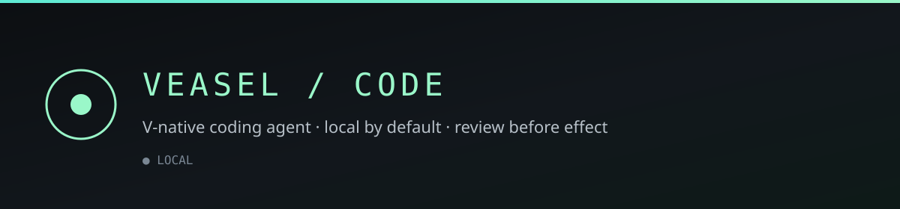

<div align="center">
  <p>
    
  </p>
  <h1>Veasel Code</h1>

[![CI][ci-badge]][ci-url]
[![Security][security-badge]][security-url]
[![Latest preview][preview-badge]][releases-url]
[![Website][website-badge]][website-url]
[![License: MIT][license-badge]][license-url]
![V-native][vnative-badge]
![Local by default][local-badge]
![OpenTUI][opentui-badge]

**Veasel Code** is an open-source AI coding agent with a **V-native runtime**,
a loopback HTTP API, and an OpenTUI terminal client. Your repo stays local;
edits, shell, and MCP wait for review before they take effect.

[veasel.dev](https://www.veasel.dev/) ·
[Docs index](docs/README.md) ·
[Implementation plan](docs/IMPLEMENTATION_PLAN.md) ·
[Providers](docs/PROVIDERS.md) ·
[Releases](https://github.com/veasel-labs/veasel/releases) ·
[Discussions](https://github.com/veasel-labs/veasel/discussions) ·
[Contributing](CONTRIBUTING.md)

</div>

<a href="docs/README.md">
  
</a>

## Start here

| Need | Go to |
|------|-------|
| Install a verified preview | [Downloads](https://www.veasel.dev/downloads) · [GitHub Releases](https://github.com/veasel-labs/veasel/releases) |
| What ships today | [Current status](#current-status) · [Implementation plan](docs/IMPLEMENTATION_PLAN.md) |
| Provider presets & setup | [docs/PROVIDERS.md](docs/PROVIDERS.md) |
| Shell security model | [docs/SHELL_COMMANDS.md](docs/SHELL_COMMANDS.md) |
| API contract | [docs/openapi.yaml](docs/openapi.yaml) |
| Release policy | [docs/RELEASES.md](docs/RELEASES.md) |
| Benchmark / ATIF honesty | [docs/benchmarking.md](docs/benchmarking.md) |
| Agent Plugins ledger | [docs/compatibility/agent-plugins.md](docs/compatibility/agent-plugins.md) |
| Full docs map | [docs/README.md](docs/README.md) |

## Install

Verified pushes to `main` publish Linux, macOS, and Windows prereleases with
SHA-256 sums. Prefer an official archive from
[GitHub Releases](https://github.com/veasel-labs/veasel/releases) or the
[downloads page](https://www.veasel.dev/downloads).

```sh
veasel --version
veasel            # starts or reuses the local server, then opens the TUI
```

Release archives include a standalone `veasel-tui` beside the V backend — Bun
is only needed when developing the terminal client from source.

## Quick start (from source)

Requirements: the V revision in [`.v-version`](.v-version), SQLite headers for
`db.sqlite`, and Bun 1.4.2+ for TUI development.

```sh
v run .
```

With no subcommand, Veasel reuses a healthy backend at `127.0.0.1:4097`, or
starts `veasel serve` and waits for health before opening the TUI. Use
`/connect` to paste an API key, save it on this machine, and pick a model —
no environment variables required. Press `s` or `/models` for full provider
settings (endpoint and output budget). Use `/theme` to switch among mint,
ember, slate, mono, and aurora.

Headless turn with the same local server and approval rules:

```sh
veasel run --prompt "Explain the request flow in this repository" --workspace . --json
```

## Current status

The working vertical slice includes:

- V HTTP server on loopback with health/capabilities, SQLite sessions & chat,
  and a replayable SSE event stream
- OpenTUI client with session list, composer, slash commands, and selectable
  themes (`/theme`)
- OpenAI-compatible, Meta Responses, Anthropic, and Gemini adapters with
  bounded streaming; provider-reported token totals via `/usage` and
  `veasel run` when adapters set `usage.reported` (no invented cost)
- Bounded workspace list/read/search; durable edit/shell/MCP proposals that
  require explicit review before effect
- Searchable, paginated durable execution history across sessions in the Solid
  TUI via `/runs`
- Agent Plugins (local READY): package discovery, durable `/plugin` links with
  install summaries, component toggles, Skills, and trusted stdio / Streamable
  HTTP MCP with per-call review (no remote marketplace — see the
  [ledger](docs/compatibility/agent-plugins.md))

Honesty bounds that stay in the product voice:

- Approved shell defaults to fail-closed OS sandboxing: Bubblewrap on Linux
  (`shell.sandbox.bubblewrap`), Seatbelt on macOS (`shell.sandbox.seatbelt`),
  or AppContainer + Job Object on Windows (`shell.sandbox.windows`). Missing
  backends refuse execution by default; `VEASEL_SHELL_SANDBOX=auto` explicitly
  permits an unsandboxed fallback and `off` disables wrapping. Windows grants
  workspace ACL to the AppContainer SID and denies network by default; it is
  not Codex-level WFP/LPAC. Trusted MCP stdio also defaults to fail-closed
  sandboxing (`VEASEL_MCP_STDIO_SANDBOX=require`); `auto` explicitly permits
  unsandboxed fallback and `off` disables wrapping. Capabilities are shown only
  when the platform wrap will run; inspect effects before approval
- Autonomous Linux shell is Bubblewrap fail-closed best-effort containment,
  not a Codex-level sandbox
- Conversation input is capped at 1 MiB; Veasel does **not** claim Muse’s full
  1,048,576-token context window
- `Prefer: respond-async` turns persist as `queued` and resume after restart;
  claimed `running`/`cancelling` work becomes `uncertain` and is never replayed
  ([durable queue](docs/compatibility/durable-queued-session-operations.md))

<details>
<summary>Provider settings, catalog scope, and credentials</summary>

The server supplies endpoint presets (including Models.dev-derived
OpenAI-compatible entries and native Meta / Anthropic / Gemini / OpenAI
Responses / local-server presets). See the
[complete provider catalog](docs/PROVIDERS.md). Preset count is not the same
as independent protocol implementations.

`/connect` is the happy path for credentials and model selection; `/models`
adds endpoint and budget controls (Ctrl+U / Ctrl+O). Keys are stored locally
in plaintext under `$VEASEL_DATA_DIR/model-settings.json` (owner-only on
POSIX). Saved profile keys win over environment variables for the same
provider; env remains an optional alternative. `VEASEL_API_URL` is accepted
only for unauthenticated loopback HTTP. The API rejects non-loopback `Host`
values and non-loopback browser `Origin` headers; settings views expose
`api_key_saved` only, never the raw key.

Custom endpoints must use HTTPS or loopback HTTP. Meta uses Responses with
high reasoning where supported.

</details>

<details>
<summary>Approvals, tools, plugins, and cancellation</summary>

In a session, `/` opens slash suggestions. Review file edits with `/patches`
and `/patch show|approve|reject <id>`; shell with `/commands` and
`/command show|approve|reject <id>`; MCP with `/mcp calls` and
`/mcp call show|approve|reject <id>`. Rejected or interrupted work is not
replayed automatically.

Agent Plugin packages are discovered from `$VEASEL_PLUGIN_DIR` or
`$VEASEL_DATA_DIR/plugins`. Standalone `SKILL.md` folders are also discovered
from project and user roots used by other agents (`.agents/skills`,
`.claude/skills`, `.codex/skills`, `.cursor/skills`, `.opencode/skills`,
`.gemini/skills`, `.pi/skills`, `.qwen/skills`, `.github/skills`, plus matching
home directories and `VEASEL_SKILLS_DIRS`). `/skills [filter]` and
`/skill on|off` manage Skills. Add configured MCP servers with
`/mcp add [user|project] stdio <name> <command> [args…]` or
`/mcp add [user|project] http <name> <url>` (user:
`$VEASEL_DATA_DIR/mcp-servers.json`; project:
`<workspace>/.veasel/mcp-servers.json`), or from the headless CLI with
`veasel mcp list|add|enable|disable|remove`. Workspace `.mcp.json` and
`.cursor/mcp.json` with portable `mcpServers` are imported read-only.
Precedence for the same name: project > project-import > user. Toggle with
`/mcp enable|disable [user|project]`, remove with `/mcp remove`, then
`/mcp trust configured/<name>`. Plugin-packaged servers still use
`/mcp trust <plugin>/<server>`. Skill instructions and MCP tool output are
untrusted reference context; Skill scripts and MCP install scripts are never
auto-executed.

Press Escape to cancel a running turn. Prefer `respond-async` clients follow
operation IDs and `session.turn_completed`. Queued turns resume after restart;
if the process dies after a worker claimed the turn, startup marks it
`uncertain` and never replays effects. See
[`docs/SHELL_COMMANDS.md`](docs/SHELL_COMMANDS.md) before enabling shell
workflows.

</details>

## API

Key routes: `/v1/health`, `/v1/capabilities`, `/v1/plugins`, `/v1/mcp-servers`,
`/v1/skills`, `/v1/sessions`, `/v1/sessions/:id/messages`, workspace
file/search/edits/commands, `/v1/sessions/:id/usage`, `/v1/events` (SSE), and
configured chat completions.
Full contract: [`docs/openapi.yaml`](docs/openapi.yaml). Agent Toolkit clients
should follow [`docs/integrations/agent-toolkit.md`](docs/integrations/agent-toolkit.md).

## Verification

```sh
v test .
scripts/api-smoke.sh
```

For memory-bounded local V checks, see [AGENTS.md](AGENTS.md). Related maps:
[`docs/VLIB_REUSE.md`](docs/VLIB_REUSE.md), [`docs/RESEARCH.md`](docs/RESEARCH.md),
[`docs/security/threat-model.md`](docs/security/threat-model.md),
[`docs/V_BUILD_PROFILE.md`](docs/V_BUILD_PROFILE.md).

## Licensing

Code is MIT. The pixel companion is an original reinterpretation of Veasel's
project-owned companion concept; the V project's official mascot artwork was
not used as an image input. See
[`THIRD_PARTY_NOTICES.md`](THIRD_PARTY_NOTICES.md) for provenance and license
notes. No endorsement by the V project is implied. The README banner and mark
in `static/` are Veasel Code originals under MIT.

## Community

[Contribution guide](CONTRIBUTING.md) · [Security](SECURITY.md) ·
[Support](SUPPORT.md) · org standards in
[veasel-labs/.github](https://github.com/veasel-labs/.github) ·
[Discussions](https://github.com/veasel-labs/veasel/discussions)

## Releases

Verified `main` builds publish versioned Linux, macOS, and Windows prereleases
with checksums and a build manifest. Policy:
[`docs/RELEASES.md`](docs/RELEASES.md). Inspect an installed binary with
`veasel --version`.

[ci-badge]: https://github.com/veasel-labs/veasel/actions/workflows/ci.yml/badge.svg?branch=main
[ci-url]: https://github.com/veasel-labs/veasel/actions/workflows/ci.yml
[security-badge]: https://github.com/veasel-labs/veasel/actions/workflows/security.yml/badge.svg?branch=main
[security-url]: https://github.com/veasel-labs/veasel/actions/workflows/security.yml
[preview-badge]: https://img.shields.io/github/v/release/veasel-labs/veasel?include_prereleases&label=preview
[releases-url]: https://github.com/veasel-labs/veasel/releases
[website-badge]: https://img.shields.io/badge/website-veasel.dev-3b6b54
[website-url]: https://www.veasel.dev/
[license-badge]: https://img.shields.io/badge/License-MIT-blue.svg
[license-url]: https://github.com/veasel-labs/veasel/blob/main/LICENSE
[vnative-badge]: https://img.shields.io/badge/runtime-V--native-9af7c9?labelColor=0c0f12
[local-badge]: https://img.shields.io/badge/default-loopback%20local-7a8794?labelColor=0c0f12
[opentui-badge]: https://img.shields.io/badge/client-OpenTUI-b7c0c8?labelColor=0c0f12
